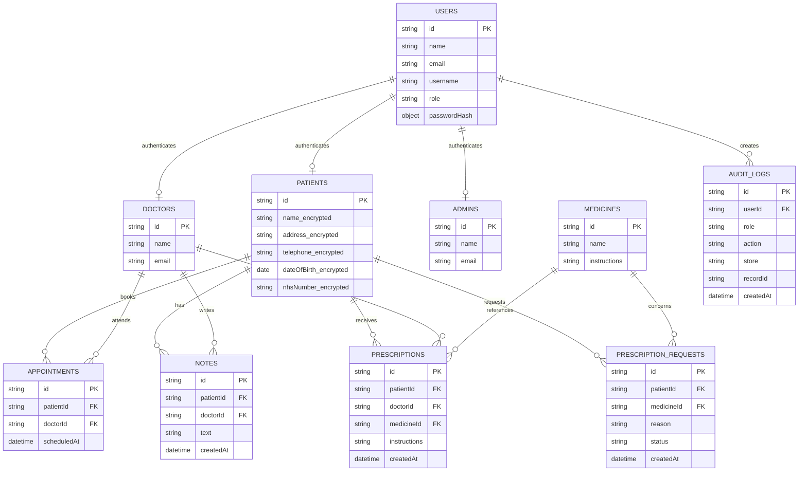

# MediCare data model

<!-- The diagram mirrors the IndexedDB stores used by the application. -->

Patient identity fields (`name`, `address`, `telephone`, `dateOfBirth` and
`nhsNumber`) are encrypted with AES-256-GCM before they are stored in
IndexedDB. Passwords are stored as salted PBKDF2 hashes rather than plaintext.

